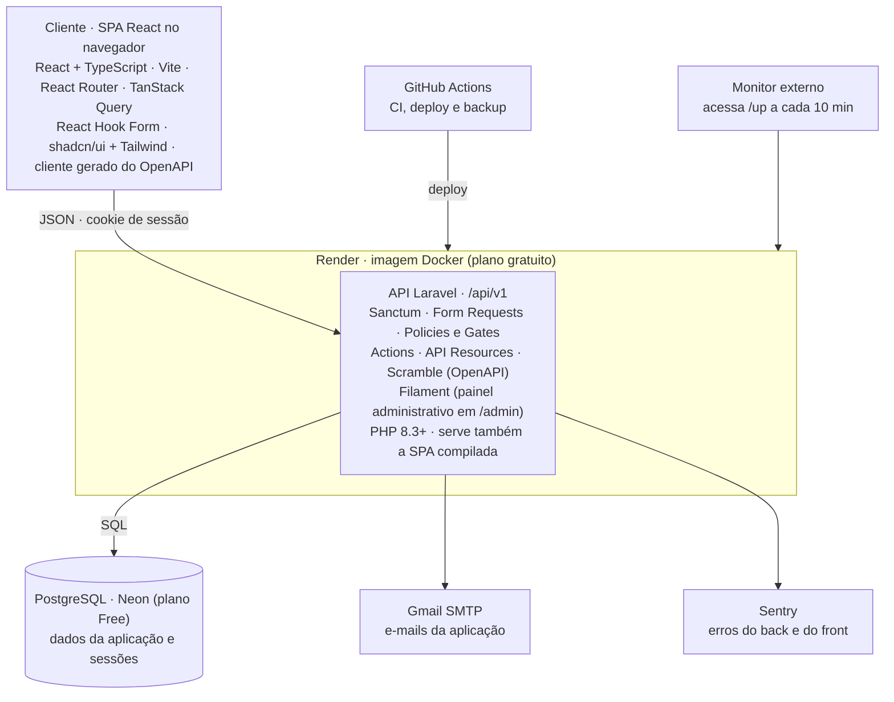

# ConectaCC - Stack e Decisões Técnicas

Última atualização: 09/11/2026

O ConectaCC é uma API REST em Laravel consumida por uma SPA em React. API, SPA e painel administrativo são publicados juntos em uma imagem Docker no Render, com PostgreSQL no Neon.

Este documento registra a stack atual, as principais decisões técnicas, as justificativas dessas escolhas e os planos condicionados para possíveis evoluções.

As regras funcionais do sistema ficam no documento de Implementação. As decisões de Produto ficam registradas em `decisoes.md`.

## Visão geral

A API é o contrato do sistema: a SPA de hoje e um eventual app móvel usam as mesmas rotas, e toda regra de negócio e de autorização fica no backend e no banco. A única tela renderizada no servidor é o painel administrativo.

## Stack por camada

Cada tecnologia abaixo está justificada na decisão indicada entre parênteses.

**Backend**

| Componente            | Escolha                                                        |
| --------------------- | -------------------------------------------------------------- |
| Linguagem e framework | PHP 8.4 e Laravel 13, usado como API (2) |
| Autenticação        | Laravel Sanctum (2)                                            |
| Validação           | Form Requests (2)                                              |
| Autorização         | Policies e Gates (2)                                           |
| Regras de negócio    | Actions, uma classe por caso de uso (2)                        |
| Respostas             | API Resources (2)                                              |
| Documentação da API | Scramble, OpenAPI gerado do código (1)                        |
| Painel administrativo | Filament (5)                                                   |
| E-mail                | Mailer do Laravel via SMTP (7)                                 |

**Frontend**

| Componente         | Escolha                                                        |
| ------------------ | -------------------------------------------------------------- |
| Biblioteca e build | React + TypeScript, Vite (3)                                   |
| Roteamento         | React Router                                                   |
| Dados do servidor  | TanStack Query (cache, loading, erro, "Mostrar mais", polling) |
| Cliente HTTP       | `openapi-typescript` + `openapi-fetch`, gerado do OpenAPI  |
| Formulários       | React Hook Form, com erros 422 mapeados para os campos         |
| Componentes        | shadcn/ui (Radix) + Tailwind                                   |

**Dados**

| Componente | Escolha                  |
| ---------- | ------------------------ |
| Banco      | PostgreSQL (4)           |
| Sessões   | No próprio Postgres (2) |

**Infraestrutura e operação**

| Componente                        | Escolha                                                 |
| --------------------------------- | ------------------------------------------------------- |
| Aplicação                       | Render, plano gratuito, imagem Docker (6)               |
| Banco de produção               | Neon, plano Free (6)                                    |
| Disponibilidade                   | Monitor externo em`/up` (6)                           |
| E-mail                            | SMTP do Gmail da conta do projeto (7)                   |
| Erros                             | Sentry, plano gratuito (8)                              |
| Repositório, CI, deploy e backup | GitHub e GitHub Actions (9, 10)                         |
| Desenvolvimento                   | Docker Compose (Sail) com PHP, PostgreSQL e Mailpit (9) |
| Runtime da imagem                 | `serversideup/php:8.4-fpm-nginx` com a extensão `intl` (9) |
| Banco em dev, CI e produção       | PostgreSQL 17 (4)                                       |
| Node                              | 24 LTS, npm (3)                                         |
| Fontes                            | Plus Jakarta Sans + Inter, auto-hospedadas (`@fontsource-variable`) |

**Qualidade**

| Componente            | Escolha                                                 |
| --------------------- | ------------------------------------------------------- |
| Testes de API         | Pest (11)                                               |
| Análise estática    | Pint, Larastan (nível 10), ESLint (com`jsx-a11y`) e `tsc` (11, 12) |
| Teste de mutação    | Pest (`--mutate`), nas classes alteradas (12)           |
| Segredos              | gitleaks no CI + secret scanning do GitHub (9)          |
| Front e ponta a ponta | Vitest, Testing Library, StrykerJS e Playwright (11, 12) |

## Decisões: arquitetura e stack

As decisões seguem o formato do `decisoes.md`: o que foi decidido, por quê, o que foi descartado e o que muda por causa disso. Tomadas em outubro de 2026 por Marcelo Henrique Germiniani Panho, com Viviane Biazus Aneris nas que afetam o produto.

### 1. Arquitetura API-first

**Decisão.** O backend é uma API REST em JSON, versionada em `/api/v1` e documentada em OpenAPI gerado do código, consumida por uma SPA. A SPA compilada é servida pelo próprio backend, na mesma origem, num único deploy.

**Motivo.**

- permitir um cliente móvel no futuro sem reescrever o backend;
- evitar CORS e cookies entre sites;
- manter um único serviço gratuito em produção.

**Alternativas descartadas.**

- monólito com telas no servidor (Livewire): não produz API reutilizável;
- SPA e API em hosts separados: CORS, cookies entre sites e dois deploys;
- backend como serviço (Supabase): regras espalhadas em policies e funções SQL; projetos gratuitos pausam após 7 dias sem uso.

**Consequência.** A API é o contrato do sistema. Toda regra de negócio e de autorização fica no backend e no banco; o frontend nunca é fonte de verdade e pode ir para outro host no futuro sem mudar a API.

### 2. Backend

**Decisão.** Laravel (PHP 8.3+), usado como API, com Sanctum, Form Requests, Policies e Gates, Actions (uma classe por caso de uso), API Resources e Scramble. Controllers são finos: recebem o Form Request, chamam uma Action e devolvem um Resource.

**Motivo.**

- domínio do desenvolvedor responsável, reduzindo o risco ao prazo;
- autenticação, recuperação de senha, limite de tentativas, policies e e-mail já prontos.

**Alternativas descartadas.**

- Node.js + TypeScript (Hono, Drizzle, Better Auth): melhor alinhamento com o currículo e uma linguagem só; maior risco ao prazo de novembro;
- Django + DRF: autenticação pronta e painel nativo, mas exigiria aprender o framework durante o prazo;
- FastAPI: autenticação completa montada à mão;
- Spring Boot: mais infraestrutura para escrever.

**Consequência.** Os alunos do curso estudam Node.js e Python, não PHP; futuros mantenedores terão que aprender PHP e Laravel. Mitigação: seguir as convenções do framework, manter o OpenAPI publicado, usar os testes de API como documentação viva e manter um README de operação. Se a continuidade se mostrar difícil, a API versionada permite reescrever o backend sem mudar o frontend.

### 3. Frontend

**Decisão.** React + TypeScript com Vite, React Router, TanStack Query, React Hook Form, shadcn/ui + Tailwind e cliente HTTP gerado do OpenAPI (`openapi-typescript` + `openapi-fetch`).

**Motivo.**

- experiência atual do desenvolvedor;
- caminho para React Native no futuro;
- componentes acessíveis prontos (foco, teclado, modais, drawer).

**Alternativa descartada.** Vue 3: atende tecnicamente e tem curva menor, mas perde nos três motivos acima.

### 4. Banco de dados

**Decisão.** PostgreSQL.

**Motivo.** `unaccent` para busca sem acentos, índices parciais para a fila de Moderação e `CHECK` constraints para garantir regras no banco.

**Alternativa descartada.** MySQL: atenderia, com menos recursos para essas regras.

### 5. Painel administrativo

**Decisão.** Filament em `/admin`, acessível somente a ADMINISTRADOR.

O painel atual permite:

- consultar usuários;
- alterar papéis de outras contas;
- consultar registros administrativos de Materiais;
- consultar Oportunidades;
- acessar a Auditoria;
- consultar informações necessárias para suporte e administração.

A aprovação e rejeição de conteúdos não são realizadas pelo Filament.

A Moderação permanece na aplicação comum e é utilizada por MODERADOR e ADMINISTRADOR.

A autoexclusão de conta e o atendimento de pedidos de exclusão através do painel não fazem parte do MVP atual.

**Motivo.** O painel concentra funções administrativas sem exigir a construção manual de uma segunda interface administrativa completa.

**Consequência.** O Filament é a única exceção à arquitetura da SPA: utiliza renderização do servidor e Livewire, mantendo o acesso restrito ao ADMINISTRADOR.

### 6. Hospedagem

**Decisão.** A aplicação é publicada no Render através de uma imagem Docker, enquanto o banco PostgreSQL de produção fica no Neon.

A hospedagem inicial é externa ao IFSul, sem domínio próprio e utilizando planos gratuitos.

O Render utiliza:

- região Virginia;
- health check em `/up`;
- deploy disparado pelo GitHub Actions somente depois do CI verde.

**Motivo.**

- custo inicial zero;
- facilidade de publicação;
- suporte a Docker;
- possibilidade de utilizar PostgreSQL externo;
- portabilidade para outro provedor futuramente.

**Consequência.** A infraestrutura foi construída de forma a reduzir dependência do provedor:

- aplicação empacotada em Docker;
- configuração por variáveis de ambiente;
- PostgreSQL padrão;
- migrations automatizadas.

Caso exista continuidade institucional, o sistema poderá ser migrado para outra infraestrutura sem alteração das regras de Produto.

O uso de monitor externo para reduzir os efeitos de hibernação do plano gratuito permanece como decisão operacional condicionada.

### 7. E-mail

**Decisão.** O MVP atual não depende de envio de e-mails em produção.

No ambiente de desenvolvimento, o Mailpit está disponível para testar funcionalidades que utilizem e-mail.

Caso Recuperação de senha ou outras funcionalidades de e-mail entrem no escopo futuramente, a primeira opção prevista é utilizar SMTP através da conta Google do projeto.

Com domínio próprio, poderá ser adotado posteriormente um provedor transacional com SPF/DKIM.

**Consequência.** A aplicação utiliza a abstração de Mailer do Laravel, permitindo trocar o provedor sem alterar as regras funcionais.

### 8. Monitoramento de erros

**Decisão.** Sentry (plano gratuito), no backend e no frontend, desde a semana de fundação. Sem envio de e-mail, nome ou corpo das requisições; usuário identificado só pelo ID interno.

**Motivo.** Sem alerta, um erro só é descoberto quando um aluno reclama, e muitos desistem sem avisar.

### 9. Repositório, contas e deploy

**Decisão.**

- monorrepo (`backend/`, `frontend/`, `docs/`) numa organização no GitHub, com Marcelo e Viviane como proprietários;
- repositório público, com varredura de segredos; `.env` fora do Git; segredos só no Render e no GitHub Actions;
- `main` protegida, mudanças por pull request com CI verde, mensagens em Conventional Commits;
- uma conta Google do projeto é dona de Render, Neon, Gmail, Sentry e monitor, com credenciais num cofre compartilhado;
- deploy: Dockerfile multiestágio que compila o React para o `public/` do Laravel; migrations com `php artisan migrate --force` na inicialização do container.

**Motivo.** A passagem para futuros mantenedores não pode depender de contas pessoais; o repositório público vale como portfólio.

### 10. Backup

**Decisão.** `pg_dump` semanal por workflow agendado no GitHub Actions, criptografado e guardado no Google Drive da conta do projeto.

**Regra.** O dump nunca vai sem criptografia para o repositório ou para artefatos públicos, porque contém dados de estudantes.

### 11. Ferramentas de teste e qualidade

**Decisão.**

- **testes de API:** Pest, rodando contra PostgreSQL real no CI;
- **análise estática:** Pint, Larastan, ESLint (com `jsx-a11y`) e `tsc`;
- **frontend e ponta a ponta:** Vitest + Testing Library e Playwright, adotados depois da liberação;
- tudo roda no GitHub Actions a cada pull request.

**Motivo.** Pest e Larastan são o padrão do ecossistema Laravel; testar contra o mesmo banco de produção é necessário porque parte das regras vive no banco.

**Consequência.** Quais testes são obrigatórios antes da liberação está definido no documento de Implementação.

### 12. Teste de mutação e análise estática pesada

**Decisão.**

- **Larastan no nível 10** (o máximo), sem lista de exceções.
- **Teste de mutação do Pest** (`--mutate`) nas classes de `backend/app` alteradas em relação à base do PR, com nota mínima de 90%. Roda no CI e no `make mutate`, antes do PR.
- **Cobertura de linhas de 100%** no back, no mesmo passo, para que código novo sem nenhum teste não passe.
- **Mutante equivalente** (que não muda o comportamento) é marcado na própria linha com `// @pest-mutate-ignore: Mutador`, e o motivo vai na linha de cima.
- **No front:** TypeScript com `strict` e `noUncheckedIndexedAccess`, ESLint com `strictTypeChecked`, testes com Vitest e Testing Library, e StrykerJS nas **linhas** de `frontend/src` alteradas, com nota mínima de 80% e sem mutar textos fixos.
- **Ponta a ponta:** specs do Playwright no repositório (`make e2e`), só no ambiente local.

> **Atualização (08/11/2026):** a parte do front entrou numa segunda entrega (`decisoes.md` 77).

**Motivo.** Os testes provavam que o código fazia o que o teste conferia, mas não que conferiam o que importa. A rodada completa de 08/11/2026 começou em 75,8% e mostrou lacunas reais: link com espaço no caminho aceito, mensagens padrão sem tradução, prazo da oportunidade não gravado nos testes, respostas da API sem formato conferido.

**Alternativas descartadas.**

- **Infection:** o padrão do PHP, mas com outra configuração. O Pest já faz mutação.
- **Mutação de tudo a cada PR:** a rodada completa leva cerca de 15 minutos. Só as classes alteradas cabem no CI.
- **Nível 6 do Larastan:** deixava passar `mixed` vindo de `config()`, `env()` e da entrada.

**Consequência.**

- O Pest muta por classe, não por linha. Mudar uma linha numa classe grande testa a classe inteira.
- O job `backend` do CI liga a cobertura (PCOV) e baixa o histórico completo do Git, para achar a base do PR.
- O `preventLazyLoading` fica ligado fora de produção. Consulta N+1 vira erro nos testes e no ambiente local.
- No front, o StrykerJS aceita intervalos de linha, então a mutação vai só no que mudou. Uma entrega que mexe em muitos arquivos de forma mecânica não precisa testar os arquivos inteiros.
- Os testes de ponta a ponta não rodam no CI: precisariam do ambiente completo (Laravel, Postgres e SPA) no runner.

### 13. Segurança da aplicação

**Decisão.**

- **Cabeçalhos de segurança** em toda resposta, e **CSP** na SPA, só com scripts do próprio site.
- **CORS fechado**, porque a SPA e a API são da mesma origem.
- **Limites:** Login por e-mail e IP (5 por minuto) e só por e-mail (10 por minuto), e um teto geral de 120 pedidos por minuto na API.
- **Proxy:** só o protocolo e a porta vêm do proxy. O IP real é resolvido pelo nginx da imagem, que confia no Cloudflare e na rede do Render.

> **Atualização (08/11/2026):** na primeira conferência em produção, o nginx da imagem duplicava os cabeçalhos (com `X-Frame-Options` em conflito) e o Laravel relia o `X-Forwarded-For`, chegando ao IP do Cloudflare. O `security.conf` do nginx ficou vazio, e o Laravel passou a usar o IP que o nginx já resolve.
- **Dependências:** auditoria do Composer e do npm sem avisos, e o Dependabot acompanhando as versões.

**Motivo.** A revisão de segurança de 08/11/2026 (OWASP Top 10) achou a API sem cabeçalhos de segurança, o host aceito do `X-Forwarded-Host`, o login sem limite por e-mail quando o IP muda e o Symfony com avisos de segurança.

**Alternativas descartadas.**

- **CSP também no `/admin`:** o Filament e o Livewire precisam de `unsafe-eval` e de scripts inline. O painel fica com os outros cabeçalhos e o acesso restrito ao ADMINISTRADOR.
- **`trustHosts`:** recusaria o health check do Render, que pode chegar com outro host.

**Consequência.** Um recurso externo novo na SPA precisa entrar na política de conteúdo, ou o navegador o bloqueia.

## Planos condicionados

Nada abaixo entra no MVP. Cada item tem um gatilho objetivo, e a maioria é troca de driver ou configuração no Laravel, sem reescrever código. O público do MVP são estudantes de CC de um câmpus, na casa das centenas; a "fila de Moderação" é uma fila de produto (consulta por status), não uma fila de mensagens.

| Item                            | Tecnologia prevista                          | Gatilho                                                     |
| ------------------------------- | -------------------------------------------- | ----------------------------------------------------------- |
| Fila de jobs                    | Driver`database` do Laravel; Redis depois  | Envio de e-mail lento ou e-mails também nas notificações |
| Notificações em tempo real    | Laravel Reverb (WebSocket)                   | Necessidade real de tempo real                              |
| Busca dedicada                  | Laravel Scout + Meilisearch                  | Milhares de registros ou relevância ruim do Postgres       |
| Cache e sessões fora do banco  | Redis                                        | Consultas lentas medidas ou mais de uma instância          |
| Upload de arquivos              | Armazenamento S3-compatível                 | Upload entrar no escopo                                     |
| Frontend em host separado       | CDN ou host estático com CORS               | Domínio próprio ou tráfego que justifique                |
| Hospedagem sem hibernação     | Institucional ou plano pago                  | Monitor não permitido ou piloto maior                      |
| Domínio próprio               | GitHub Student Pack (1 ano) ou institucional | Antes de um piloto maior ou da divulgação ao curso        |
| E-mail transacional             | Provedor com SPF/DKIM                        | Domínio próprio ou Gmail indo para spam                   |
| Testes de front e ponta a ponta | Vitest; Playwright                           | Após a liberação, antes de um piloto maior               |

> **Atualização (08/11/2026):** Vitest, Testing Library e Playwright foram adotados antes do previsto (decisão 12). Do item acima, sobra só rodar o Playwright no CI.

**Caminho para o celular**, do mais barato ao mais caro; cada passo só se o anterior não bastar, e em nenhum deles o backend muda:

1. **PWA:** manifest e service worker na SPA atual; instalável, sem lojas.
2. **Capacitor:** a mesma SPA empacotada para as lojas; exige pagar as contas de desenvolvedor.
3. **React Native (Expo):** app nativo consumindo `/api/v1` com token Sanctum; só com demanda demonstrada.

## Pontos provisórios

Decisões de tecnologia em vigor, mas que podem mudar. As regras provisórias de funcionamento ficam no documento de Implementação.

- **Monitor contra hibernação (6):** depende de os termos do Render permitirem; caso contrário, os alunos são avisados de que o primeiro acesso pode demorar.
- **Hospedagem fora do IFSul (6):** inicial; pode migrar para hospedagem institucional sem mudança de código.
- **SMTP do Gmail (7):** até haver domínio próprio.
